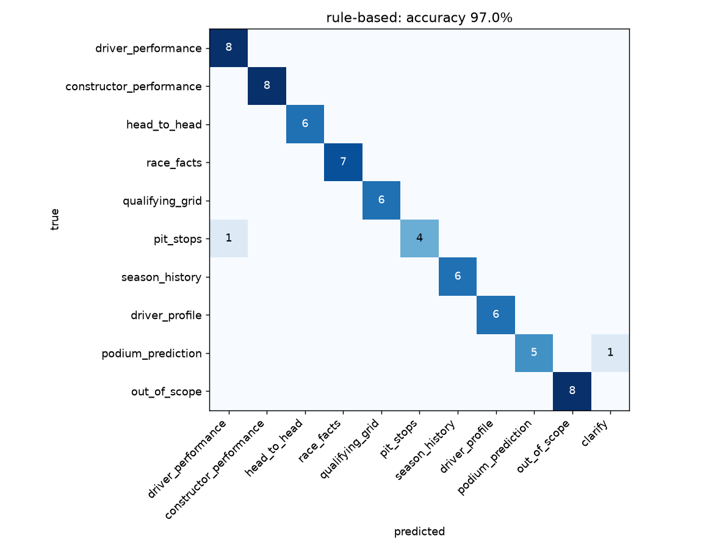
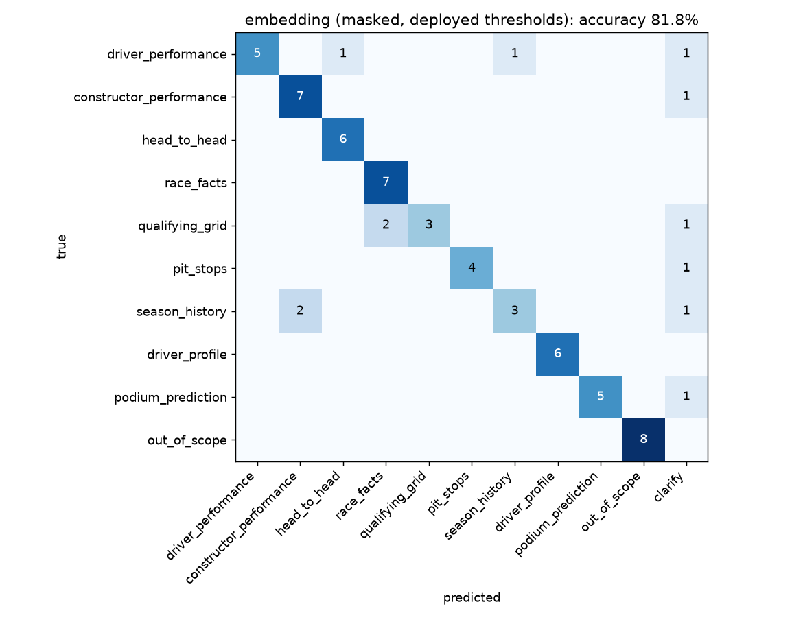
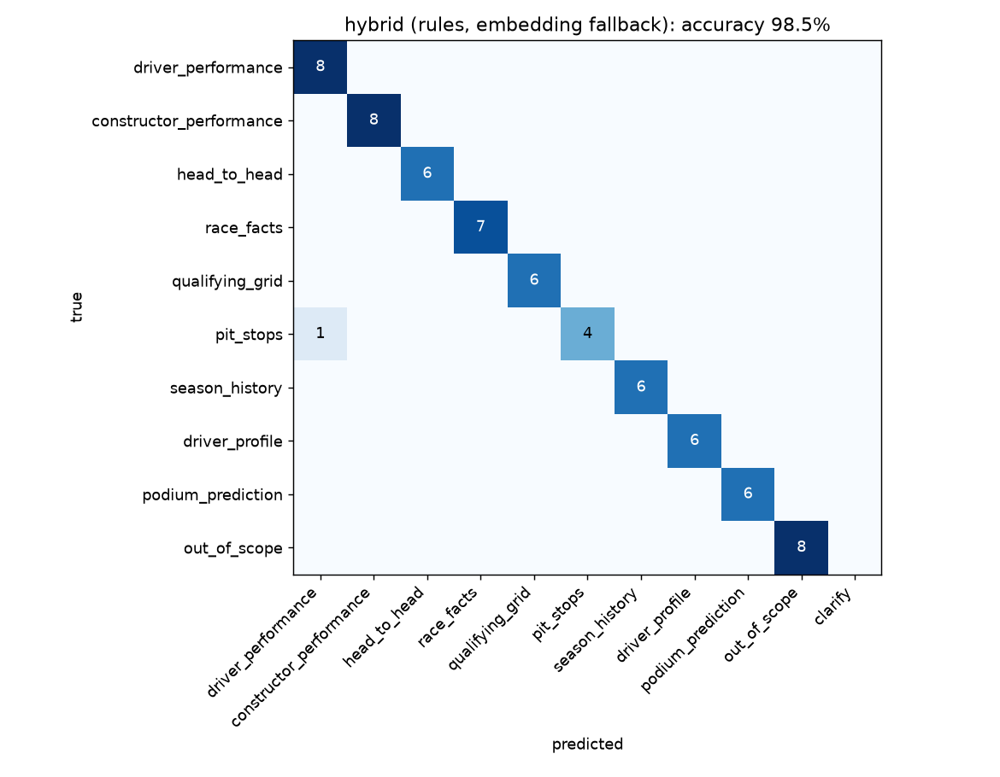

# Intent classification: rule-based vs embedding similarity

Test set: `m3/eval/intent_testset.csv`, 66 questions, {'driver_performance': 8, 'constructor_performance': 8, 'head_to_head': 6, 'race_facts': 7, 'qualifying_grid': 6, 'pit_stops': 5, 'season_history': 6, 'driver_profile': 6, 'podium_prediction': 6, 'out_of_scope': 8}. Phrased differently from the classifier examples (checked: no test question equals an example). Rows with `prev_intent` are follow-ups evaluated with that cached intent.

Embedding model: `sentence-transformers/all-MiniLM-L6-v2`, min score 0.45, margin 0.03.

## rule-based

Accuracy **97.0%** (64/66), asked to rephrase on 1.5%.

| true \ pred | driver_per | constructo | head_to_he | race_facts | qualifying | pit_stops | season_his | driver_pro | podium_pre | out_of_sco | clarify |
|---|---|---|---|---|---|---|---|---|---|---|---|
| driver_performance | 8 | . | . | . | . | . | . | . | . | . | . |
| constructor_performance | . | 8 | . | . | . | . | . | . | . | . | . |
| head_to_head | . | . | 6 | . | . | . | . | . | . | . | . |
| race_facts | . | . | . | 7 | . | . | . | . | . | . | . |
| qualifying_grid | . | . | . | . | 6 | . | . | . | . | . | . |
| pit_stops | 1 | . | . | . | . | 4 | . | . | . | . | . |
| season_history | . | . | . | . | . | . | 6 | . | . | . | . |
| driver_profile | . | . | . | . | . | . | . | 6 | . | . | . |
| podium_prediction | . | . | . | . | . | . | . | . | 5 | . | 1 |
| out_of_scope | . | . | . | . | . | . | . | . | . | 8 | . |

Per-intent recall: driver_performance 100%, constructor_performance 100%, head_to_head 100%, race_facts 100%, qualifying_grid 100%, pit_stops 80%, season_history 100%, driver_profile 100%, podium_prediction 83%, out_of_scope 100%

Errors:

- `How many stops did the drivers make on average at Silverstone in 2021?` true **pit_stops**, got **driver_performance** (top score)
- `What would the model say about Russell in Las Vegas 2024 from pole?` true **podium_prediction**, got **clarify** (tie between podium_prediction and qualifying_grid)

## embedding (masked, deployed thresholds)

Accuracy **81.8%** (54/66), asked to rephrase on 9.1%.

| true \ pred | driver_per | constructo | head_to_he | race_facts | qualifying | pit_stops | season_his | driver_pro | podium_pre | out_of_sco | clarify |
|---|---|---|---|---|---|---|---|---|---|---|---|
| driver_performance | 5 | . | 1 | . | . | . | 1 | . | . | . | 1 |
| constructor_performance | . | 7 | . | . | . | . | . | . | . | . | 1 |
| head_to_head | . | . | 6 | . | . | . | . | . | . | . | . |
| race_facts | . | . | . | 7 | . | . | . | . | . | . | . |
| qualifying_grid | . | . | . | 2 | 3 | . | . | . | . | . | 1 |
| pit_stops | . | . | . | . | . | 4 | . | . | . | . | 1 |
| season_history | . | 2 | . | . | . | . | 3 | . | . | . | 1 |
| driver_profile | . | . | . | . | . | . | . | 6 | . | . | . |
| podium_prediction | . | . | . | . | . | . | . | . | 5 | . | 1 |
| out_of_scope | . | . | . | . | . | . | . | . | . | 8 | . |

Per-intent recall: driver_performance 62%, constructor_performance 88%, head_to_head 100%, race_facts 100%, qualifying_grid 50%, pit_stops 80%, season_history 50%, driver_profile 100%, podium_prediction 83%, out_of_scope 100%

Errors:

- `On average where did Alonso finish at the Hungaroring?` true **driver_performance**, got **clarify** (driver_performance 0.80 too close to head_to_head 0.79)
- `How did Schumacher do in terms of victories in 2004?` true **driver_performance**, got **head_to_head** (top score)
- `How many points did he score in 2019?` true **driver_performance**, got **season_history** (top score)
- `Which share of McLaren's starts ended with the car classified in 2015?` true **constructor_performance**, got **clarify** (season_history 0.55 too close to constructor_performance 0.55)
- `Who started first at the 2022 Belgian Grand Prix?` true **qualifying_grid**, got **race_facts** (top score)
- `Biggest climber from his starting slot at the 2021 Brazilian GP?` true **qualifying_grid**, got **race_facts** (top score)
- `How often did Norris make it into the final qualifying session in 2023?` true **qualifying_grid**, got **clarify** (qualifying_grid 0.75 too close to season_history 0.73)
- `How many stops did the drivers make on average at Silverstone in 2021?` true **pit_stops**, got **clarify** (pit_stops 0.78 too close to driver_performance 0.78)
- `Which driver collected the title in 2008?` true **season_history**, got **clarify** (head_to_head 0.71 too close to driver_performance 0.71)
- `Who moved to a new team ahead of 2019?` true **season_history**, got **constructor_performance** (top score)
- `How many rounds made up the 1998 season?` true **season_history**, got **constructor_performance** (top score)
- `Odds of Perez getting a podium at Baku 2023?` true **podium_prediction**, got **clarify** (podium_prediction 0.77 too close to driver_performance 0.75)

## hybrid (rules, embedding fallback)

Accuracy **98.5%** (65/66), asked to rephrase on 0.0%.

| true \ pred | driver_per | constructo | head_to_he | race_facts | qualifying | pit_stops | season_his | driver_pro | podium_pre | out_of_sco | clarify |
|---|---|---|---|---|---|---|---|---|---|---|---|
| driver_performance | 8 | . | . | . | . | . | . | . | . | . | . |
| constructor_performance | . | 8 | . | . | . | . | . | . | . | . | . |
| head_to_head | . | . | 6 | . | . | . | . | . | . | . | . |
| race_facts | . | . | . | 7 | . | . | . | . | . | . | . |
| qualifying_grid | . | . | . | . | 6 | . | . | . | . | . | . |
| pit_stops | 1 | . | . | . | . | 4 | . | . | . | . | . |
| season_history | . | . | . | . | . | . | 6 | . | . | . | . |
| driver_profile | . | . | . | . | . | . | . | 6 | . | . | . |
| podium_prediction | . | . | . | . | . | . | . | . | 6 | . | . |
| out_of_scope | . | . | . | . | . | . | . | . | . | 8 | . |

Per-intent recall: driver_performance 100%, constructor_performance 100%, head_to_head 100%, race_facts 100%, qualifying_grid 100%, pit_stops 80%, season_history 100%, driver_profile 100%, podium_prediction 100%, out_of_scope 100%

Errors:

- `How many stops did the drivers make on average at Silverstone in 2021?` true **pit_stops**, got **driver_performance** (top score)

## Ablation: masking entities before embedding

Without masking (raw text embedded): accuracy 66.7%; with masking: 81.8%.

## Threshold sensitivity (embedding)

| min score | margin | accuracy | rephrase rate |
|---|---|---|---|
| 0.35 | 0.0 | 87.9% | 0.0% |
| 0.35 | 0.03 | 81.8% | 9.1% |
| 0.35 | 0.06 | 72.7% | 24.2% |
| 0.45 | 0.0 | 87.9% | 0.0% |
| 0.45 | 0.03 | 81.8% | 9.1% |
| 0.45 | 0.06 | 72.7% | 24.2% |
| 0.55 | 0.0 | 87.9% | 1.5% |
| 0.55 | 0.03 | 81.8% | 10.6% |
| 0.55 | 0.06 | 72.7% | 24.2% |

## Held-out set (22 questions): rule-based

Accuracy 68.2%. Errors:

- `Number of Grand Prix victories for Nico Rosberg in 2016?` true **driver_performance**, got **driver_profile** (top score)
- `What's Daniel Ricciardo's typical finishing spot at Monaco?` true **driver_performance**, got **clarify** (no intent keyword matched)
- `Was Piastri or Norris stronger in 2024?` true **head_to_head**, got **clarify** (no intent keyword matched)
- `Who stood on the top step at the 2005 Japanese GP?` true **race_facts**, got **clarify** (no intent keyword matched)
- `Which country is Kevin Magnussen from?` true **driver_profile**, got **race_facts** (top score)
- `Who will win the next election?` true **out_of_scope**, got **driver_performance** (top score)
- `How much fuel does an F1 car carry?` true **out_of_scope**, got **constructor_performance** (top score)

## Held-out set (22 questions): embedding (masked, deployed thresholds)

Accuracy 63.6%. Errors:

- `Number of Grand Prix victories for Nico Rosberg in 2016?` true **driver_performance**, got **clarify** (race_facts 0.79 too close to qualifying_grid 0.76)
- `Which season brought Alpine the most points?` true **constructor_performance**, got **clarify** (season_history 0.79 too close to constructor_performance 0.79)
- `Who stood on the top step at the 2005 Japanese GP?` true **race_facts**, got **clarify** (qualifying_grid 0.83 too close to race_facts 0.80)
- `Which drivers qualified in the top ten at Suzuka 2019?` true **qualifying_grid**, got **clarify** (qualifying_grid 0.79 too close to driver_performance 0.77)
- `How many front-row starts did Bottas have in 2017?` true **qualifying_grid**, got **head_to_head** (top score)
- `Did Ricciardo stop once or twice at Baku 2018?` true **pit_stops**, got **clarify** (pit_stops 0.74 too close to driver_performance 0.74)
- `Who will win the next election?` true **out_of_scope**, got **clarify** (best score 0.31 < 0.45)
- `How much fuel does an F1 car carry?` true **out_of_scope**, got **driver_profile** (top score)

## Held-out set (22 questions): hybrid (rules, embedding fallback)

Accuracy 77.3%. Errors:

- `Number of Grand Prix victories for Nico Rosberg in 2016?` true **driver_performance**, got **driver_profile** (top score)
- `Who stood on the top step at the 2005 Japanese GP?` true **race_facts**, got **clarify** (rules undecided (no intent keyword matched); embedding: qualifying_grid 0.83 too close to race_facts 0.80)
- `Which country is Kevin Magnussen from?` true **driver_profile**, got **race_facts** (top score)
- `Who will win the next election?` true **out_of_scope**, got **driver_performance** (top score)
- `How much fuel does an F1 car carry?` true **out_of_scope**, got **constructor_performance** (top score)

## Summary

| classifier | test accuracy | rephrase rate | held-out accuracy |
|---|---|---|---|
| rule-based | 97.0% | 1.5% | 68.2% |
| embedding (masked, deployed thresholds) | 81.8% | 9.1% | 63.6% |
| hybrid (rules, embedding fallback) | 98.5% | 0.0% | 77.3% |
